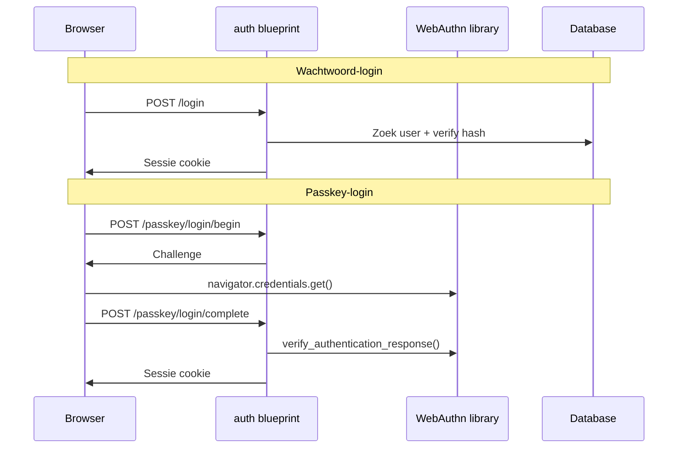

# Architectuur

## Overzicht

Fris is een Flask-webapplicatie met een **lagenarchitectuur**:

```
Browser  →  Blueprints (routes)  →  Services  →  Models  →  SQLite
```

| Laag | Verantwoordelijkheid |
|------|---------------------|
| **Blueprints** | HTTP-verzoeken, formulieren, responses |
| **Services** | Bedrijfslogica (statistieken, tips) |
| **Models** | Database-entiteiten (SQLAlchemy) |
| **Extensions** | Gedeelde Flask-extensies (db, login, CSRF) |

## Mappenstructuur

```
fris-alcoholmanagement/
├── app/                        # Applicatiepackage
│   ├── __init__.py             # Application factory (create_app)
│   ├── config.py               # Configuratie (uit omgevingsvariabelen / .env)
│   ├── constants.py            # Vaste waarden (formulieropties, limieten)
│   ├── extensions.py           # db, csrf, login_manager
│   ├── security.py             # Security headers, CSP-nonce, inlog-rem
│   ├── migrate.py              # Lichte migraties bij opstarten
│   ├── data/                   # Inhoud stopfasen (teksten)
│   ├── blueprints/
│   │   ├── auth/               # Login, registratie, passkeys
│   │   └── main/               # Dashboard, log, doelen, profiel, dagboek, export en account verwijderen
│   ├── models/
│   │   ├── user.py             # User, Profile, WebAuthnCredential
│   │   ├── drink.py            # DrinkLog
│   │   ├── goal.py             # Goal
│   │   └── journal.py          # JournalEntry
│   ├── services/
│   │   ├── stats_service.py    # Trends en statistieken
│   │   ├── tips_service.py     # Gepersonaliseerde tips
│   │   ├── badges_service.py   # Mijlpalen (reeksen alcoholvrije dagen)
│   │   ├── cessation_phase_service.py  # Begeleiding per stopfase
│   │   ├── gaps_service.py     # Gemiste dagen detecteren
│   │   ├── drinks_service.py   # Drankjes → standaardglazen
│   │   ├── journal_service.py  # Dagboek + HTML-sanitisatie
│   │   ├── account_service.py  # Gegevens exporteren en account verwijderen
│   │   ├── demo_service.py     # Demo-modus: voorbeeldaccounts en opruimen
│   │   ├── email_service.py    # SMTP / log-fallback
│   │   └── tokens.py           # Wachtwoordreset-tokens
│   ├── static/                 # CSS, JavaScript, PWA, vendor/ (Chart.js, Quill)
│   └── templates/              # Jinja2 HTML-templates
├── data/                       # SQLite-database (niet in git)
├── docs/                       # Documentatie
├── migrations/                 # SQL-schema scripts
├── tests/                      # Pytest tests
├── Dockerfile                  # Container-image (Gunicorn)
├── render.yaml                 # Render Blueprint voor de openbare demo
├── run.py                      # Development entry point
└── requirements.txt
```

## Ontwerpkeuzes

### Application factory

`create_app()` in `app/__init__.py` maakt de Flask-app configureerbaar. Dit maakt testen eenvoudig (in-memory database) en ondersteunt meerdere configuraties.

### Blueprints per domein

- **auth**: Authenticatie (wachtwoord + WebAuthn passkeys)
- **main**: Kernfunctionaliteit (dashboard, registratie, doelen)

### Services voor bedrijfslogica

Statistieken en tips zitten niet in routes of models. Routes blijven dun; logica is testbaar en herbruikbaar.

### SQLite

Eenvoudigste database, geen aparte server nodig. Geschikt voor persoonlijk gebruik en prototyping.

## Beveiliging

| Maatregel | Implementatie |
|-----------|--------------|
| Wachtwoord-opslag | Werkzeug `generate_password_hash` |
| Sessies | Flask-Login, HTTP-only cookies |
| CSRF | Flask-WTF op alle formulieren |
| Passkeys | WebAuthn (FIDO2) via `webauthn` library |
| Gegevensisolatie | Queries filteren altijd op `user_id` |
| Headers en CSP | `app/security.py` — zie [security.md](security.md) voor het volledige overzicht |

## Authenticatie-flow



## Frontend

Server-side rendered HTML (Jinja2) met minimale JavaScript:

- **Chart.js** voor trendgrafieken op het dashboard (lokaal in `static/vendor/`)
- **Quill** als editor voor het dagboek (lokaal in `static/vendor/`)
- **webauthn.js** voor passkey-registratie en -login
- **sw.js** / **pwa.js** service worker voor de installeerbare PWA

Geen SPA-framework — bewust eenvoudig gehouden.
