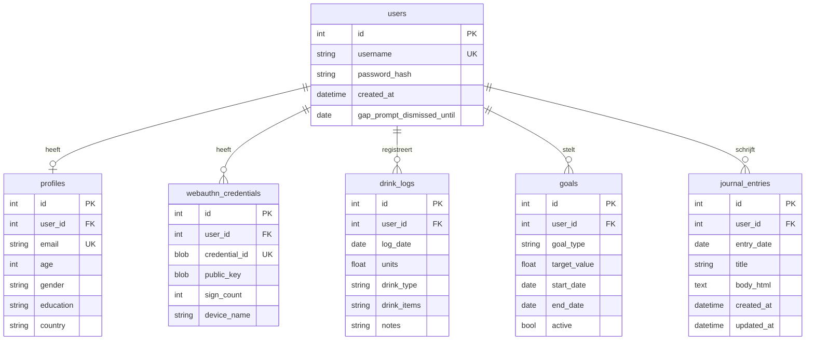

# Database

## Overzicht

De applicatie gebruikt **SQLite** (`data/minder_drinken.db`). Tabellen worden automatisch aangemaakt bij opstarten via `db.create_all()`.

SQL-schema documentatie staat in `migrations/`.

## Entity-relationship

## Tabellen

### users

Accountgegevens. Wachtwoorden worden gehasht opgeslagen (nooit plaintext).

### profiles

Optionele profielgegevens, één-op-één met `users`. Gebruikt voor gepersonaliseerde richtlijnen (bijv. 7 vs 14 glazen/week).

### webauthn_credentials

Passkey-gegevens per apparaat. `credential_id` en `public_key` zijn binary blobs.

### drink_logs

Dagelijkse alcoholregistratie. **Één record per gebruiker per dag** — een nieuwe invoer overschrijft de bestaande.

| Kolom | Type | Beschrijving |
|-------|------|-------------|
| `units` | float | Aantal standaardglazen (0 = alcoholvrije dag) |
| `drink_type` | string | Leesbare samenvatting, bijv. "2× Tripel, 1× Wijnglas" |
| `drink_items` | string (JSON) | Aantallen per dranksoort |
| `notes` | string | Optionele notitie (max 255 tekens) |

### goals

Gebruikersdoelen. Types:

| `goal_type` | Betekenis |
|-------------|-----------|
| `weekly_units` | Maximaal X standaardglazen per week |
| `dry_days` | Minimaal X alcoholvrije dagen per week |
| `abstain` | Volledig stoppen (`target_value` = 0) |

Slechts één doel tegelijk actief per gebruiker.

### journal_entries

Dagboekentries. `body_html` wordt bij opslaan gesanitized met `bleach` (alleen basisopmaak en links).

## Migraties

| Script | Beschrijving |
|--------|-------------|
| `migrations/001_initial.sql` | Initieel schema |
| `migrations/002_expand_drink_type.sql` | Langere `drink_type` |
| `migrations/002_gap_prompt_dismissed.sql` | `users.gap_prompt_dismissed_until` |
| `migrations/003_add_profile_email.sql` | `profiles.email` |
| `migrations/004_add_drink_items.sql` | `drink_logs.drink_items` |
| `migrations/005_add_journal_entries.sql` | Tabel `journal_entries` |

Kolommen die later zijn toegevoegd worden bij opstarten automatisch bijgewerkt door `app/migrate.py`.

De database bevat gevoelige gegevens en staat niet in git (`data/` staat in `.gitignore`).

Bij wijzigingen aan modellen: maak een nieuw genummerd SQL-script en pas de modellen aan. Voor productie is Alembic aan te raden; voor dit project volstaan handmatige scripts.

## Standaardglas

1 standaardglas = **10 gram pure alcohol** (Nederlandse definitie):

- 1 glas bier (250 ml)
- 1 glas wijn (100 ml)
- 1 shot sterke drank (35 ml)

Richtlijnen (RIVM/Trimbos): max 14/week (mannen), 7/week (vrouwen), minstens 2–3 alcoholvrije dagen.
